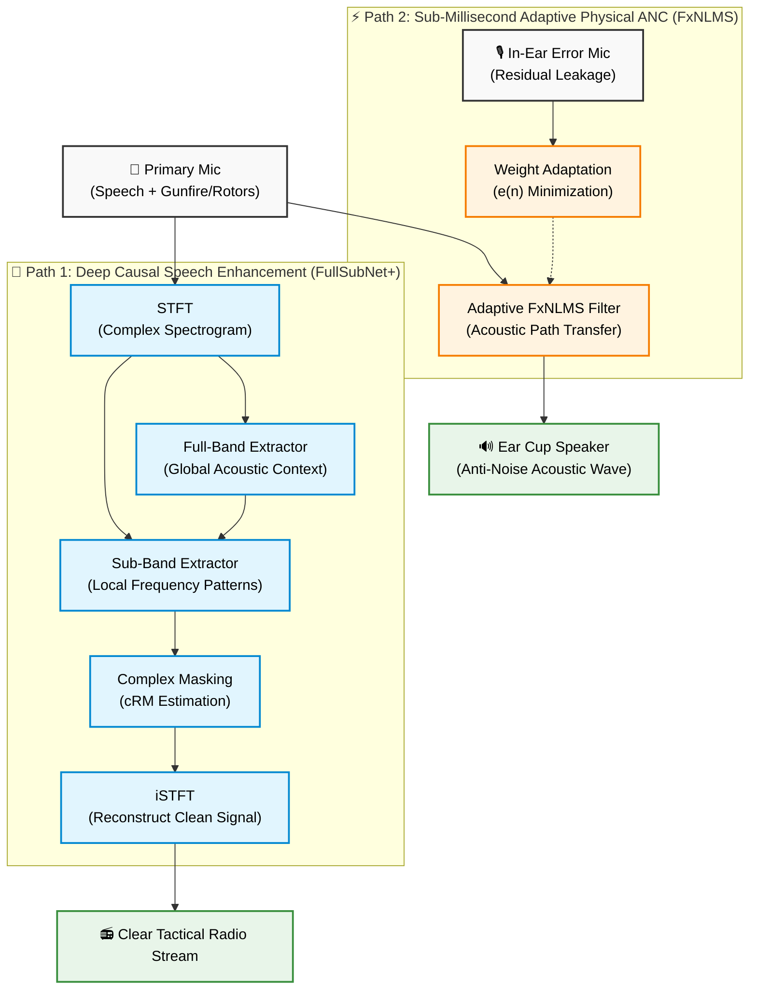

# 🛡️ AEGIS-ANC: AI-Enhanced Ground Infantry System — Active Noise Cancellation

[](https://github.com/imayavaramban11/HeXhawks/actions)
[](https://www.python.org/)
[](https://pytorch.org/)
[](https://opensource.org/licenses/MIT)
[](https://www.sih.gov.in/)

> **Next-generation indigenous tactical communication headset combining Deep Causal AI Speech Enhancement with Sub-Millisecond Adaptive Physical ANC for extreme military environments.**

---

## 📌 Executive Summary

Modern infantry combat environments regularly exceed **140+ dB SPL** due to gunshots, artillery strikes, helicopter rotor wash, and armored vehicle engines. 

* **The Problem:** Current military communication headsets rely strictly on conventional analog/DSP filters that fail against sharp non-stationary impulse sounds (gunshots, explosions). Passive ear protection cuts down noise but leaves soldiers tactically isolated and deaf to squad whisper commands or footfalls.
* **Our Solution:** **AEGIS-ANC** features a **Hybrid Dual-Path Architecture**. It runs **Hardware DSP (FxNLMS)** in parallel with **Deep Causal AI (FullSubNet+)** to simultaneously attenuate low-frequency vehicle rumble (<1ms physical anti-noise) and isolate clean radio speech from deafening impulse noise (<20ms latency), completely offline on body-worn edge compute.

---

## 🏛️ System Architecture



---

## ⚡ Key Innovations & USPs

1. **Dual-Path Hybrid Topology:** Decouples physical wave cancellation (<1ms) from non-stationary speech separation (<20ms), overcoming the fundamental speed-of-sound latency barrier.
2. **Impulse-Aware Custom Loss:** Penalizes residual energy spikes during gunfire and blast events without clipping or distorting natural vocal formants.
3. **Complex-Domain Phase Preservation:** Preserves real and imaginary spectrogram features (cRM), eliminating the robotic artifacts typical of conventional AI speech masks.
4. **Strict Causal Architecture:** Zero lookahead frames ensures real-time streaming capability in live tactical combat.
5. **Intelligent Situational Awareness (Hear-Through):** Safely attenuates deafening blasts (>85 dB) while passing through safe tactical cues (footsteps, squad whispers).
6. **100% Offline & Jam-Proof:** Operates on edge compute (NVIDIA Jetson / COTS embedded hardware) with zero RF footprint and complete electronic warfare immunity.

---

## 📂 Repository Structure

```
HeXhawks/
├── .github/
│   └── workflows/
│       └── ci.yml               # Automated CI test pipeline
├── ai_enhancement/
│   ├── configs/                 # Hyperparameters (Audio, Model, Data, Train)
│   ├── data/                    # Sample data directories (.gitkeep)
│   │   ├── clean_speech/
│   │   └── defence_noise/
│   ├── src/                     # Core system modules
│   │   ├── __init__.py          # Public Python API
│   │   ├── audio.py             # Audio I/O, resampling, and normalization
│   │   ├── config.py            # AudioConfig, ModelConfig, DataConfig, TrainConfig
│   │   ├── dataset.py           # On-the-fly dynamic SNR mixer & impulse injector
│   │   ├── dsp_fxnlms.py        # Sub-ms FxNLMS adaptive filter & parallel hybrid engine
│   │   ├── loss.py              # ImpulseWeightedL1Loss & MultiResolutionSTFTLoss
│   │   ├── metrics.py           # SI-SDR, SNR improvement, STOI, and PESQ
│   │   ├── model.py             # CausalFullSubNetPlus (216k parameters)
│   │   ├── modules.py           # CausalConv1d, MulCA ChannelAttention, TCN, SubBand
│   │   ├── stft.py              # PyTorch STFT and iSTFT reconstruction
│   │   └── streaming.py         # Sub-20ms real-time sliding buffer inferencer
│   ├── tests/                   # 33 automated unit tests (100% passing)
│   │   ├── test_audio.py
│   │   ├── test_dataset.py
│   │   ├── test_dsp_fxnlms.py
│   │   ├── test_loss_and_metrics.py
│   │   ├── test_model.py
│   │   ├── test_stft.py
│   │   ├── test_streaming_and_export.py
│   │   └── test_train_and_eval.py
│   ├── download_datasets.py     # Automated dataset setup tool
│   ├── train.py                 # Multi-epoch AdamW training & checkpointing
│   ├── evaluate.py              # 4-stage benchmark evaluation suite
│   ├── export.py                # Standalone ONNX edge deployment exporter
│   └── requirements.txt         # Python dependencies
├── architecture_flowchart.md    # Detailed architecture documentation
├── complete_project_guide.md    # Full engineering & algorithmic manual
├── .gitignore                   # Clean exclusion rules for large datasets
└── README.md                    # Project documentation
```

---

## 🚀 Getting Started

### 1. Prerequisites
- Python 3.10, 3.11, or 3.12
- Git (with [Git LFS](https://git-lfs.com/) recommended for large models)

### 2. Clone and Setup Environment

```bash
# Clone the repository
git clone https://github.com/imayavaramban11/HeXhawks.git
cd HeXhawks

# Create and activate a virtual environment
python -m venv .venv

# On Windows (PowerShell):
.venv\Scripts\Activate.ps1
# On Linux/macOS:
source .venv/bin/activate

# Install dependencies
pip install -r ai_enhancement/requirements.txt
```

### 3. Run Unit Tests

Execute the comprehensive test suite (33 tests covering causality, reconstruction, FxNLMS, and ONNX export):

```bash
pytest ai_enhancement/tests -v
```

### 4. Training the Model

Train the Causal FullSubNet+ model using on-the-fly dynamic mixing with impulse-aware loss:

```bash
python ai_enhancement/train.py --epochs 20 --batch-size 4 --lr 5e-4
```

### 5. Running the 4-Stage Benchmark

Evaluate unprocessed noisy vs. physical ANC vs. AI enhancement vs. the full hybrid system:

```bash
python ai_enhancement/evaluate.py --samples 16 --save-json benchmark_results.json
```

### 6. Exporting to Edge Hardware (ONNX / Jetson)

Export trained weights to a lightweight, standalone ONNX model (< 1 MB) for embedded deployment:

```bash
python ai_enhancement/export.py --output ai_enhancement/checkpoints/aegis_anc.onnx
```

---

## 📊 Datasets & Training Setup

AEGIS-ANC uses a synthetic mixing pipeline combining clean speech with military-grade non-stationary noise and Room Impulse Responses (RIRs).

| Category | Recommended Dataset | Purpose | Source |
|---|---|---|---|
| **Clean Speech** | VCTK Corpus / LibriSpeech | Target voice signals | [VCTK Edinburgh](https://datashare.ed.ac.uk/handle/10283/3443) |
| **Defence Noise** | Military Audio Dataset (MAD) | Gunshots, helicopters, explosions | [Kaggle MAD](https://www.kaggle.com/datasets/kaen2891/military-audio-dataset) |
| **Environmental Noise** | ESC-50 / DNS-Challenge | General background ambient noise | [ESC-50 GitHub](https://github.com/karoldvl/ESC-50) |
| **Acoustic RIRs** | OpenSLR SLR28 | Enclosed acoustic simulation | [OpenSLR SLR28](https://www.openslr.org/28/) |

To download dataset subsets automatically:
```bash
# Download ESC-50 (battlefield and engine sounds)
python ai_enhancement/download_datasets.py --esc50

# Download essential DNS Challenge subsets
python ai_enhancement/download_datasets.py --dns
```

---

## 👥 Authors & Team

Developed by **Team HeXhawks** for the **Smart India Hackathon (SIH)**.

* **GitHub:** [@imayavaramban11](https://github.com/imayavaramban11)

---

## 📄 License

This project is licensed under the MIT License — see the LICENSE file for details.
