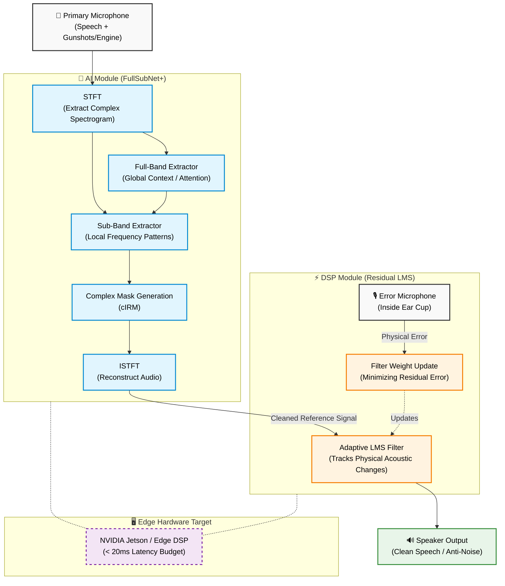

# Architecture Flowchart: Hybrid IA-FullSubNet+ & LMS

Here is the visual representation of our proposed pipeline. 

### How to Read This Flowchart:

1. **The Input (Top):** The primary microphone picks up the chaotic battlefield environment (speech mixed with impulsive and stationary noises).
2. **The AI Brain (Blue):** The signal is converted into the complex domain. The Full-Band extractor looks at the "big picture" to identify what is speech and what is a gunshot. The Sub-Band extractor cleans up specific frequency ranges. It outputs a perfectly cleaned digital signal.
3. **The DSP Reflex (Orange):** Because the physical headset moves and acoustics change, we cannot play the AI's signal blindly. We use the AI's cleaned output as a guide for a lightning-fast LMS filter. The LMS compares the guide against what the error microphone is actually hearing inside the headset, and continuously adjusts itself.
4. **The Output (Green):** The final, physically accurate anti-noise is played through the speaker, canceling the environment while preserving the user's speech.
5. **The Deployment (Purple):** Both the AI and DSP modules must be optimized to run concurrently on embedded edge hardware with strict latency constraints.
