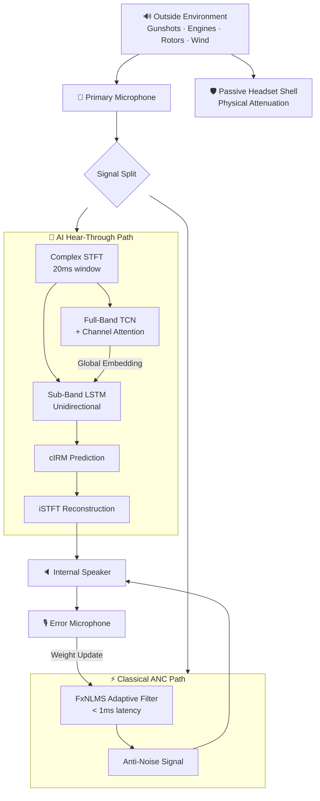

# COMPLETE PROJECT UNDERSTANDING: SIH 26052 Defence ANC

---

# 1. PROJECT RECONSTRUCTION FROM ALL MATERIALS

## What the project actually is

There is a **terminology tension** in the project materials that must be resolved upfront:

| Source | Title Used |
|---|---|
| Original prompt | "FullSubNet+: Channel Attention and Complex Spectrograms for Speech Enhancement" |
| SIH problem statement | "SIH26052: AI/ML-Enabled Adaptive Noise Cancellation for Defence" |
| Architecture audits | "Causal FullSubNet+-Inspired Speech Enhancement + Parallel FxNLMS ANC" |

**Resolution:** The project title for SIH is **"AI/ML-Enabled Active Noise Cancellation for Defence Communication."** The "FullSubNet+" reference describes the *specific neural architecture* we chose for the AI component. FullSubNet+ is not the project — it is one component inside the project.

### Exact Project Details (Reconstructed)

| Field | Detail |
|---|---|
| **Project Title** | AI/ML-Enabled Adaptive Noise Cancellation for Defence Communication (SIH 26052) |
| **Problem Statement** | Suppress stationary, non-stationary, and impulsive defence noises while preserving speech intelligibility in real-time on embedded hardware |
| **Motivation** | Soldiers cannot communicate effectively when surrounded by gunshots, explosions, engine noise, and rotors. Classical ANC (LMS/FxLMS) fails on non-stationary and impulsive noise. |
| **Objectives** | SNR > 15 dB, STOI > 0.85, PESQ > 2.5, real-time on NVIDIA Jetson Orin |
| **Existing System** | Classical adaptive filters (LMS, NLMS, FxLMS) + passive ear protection |
| **Existing Limitations** | Classical filters assume stationary noise, fail on gunshots/explosions, cannot distinguish speech from noise |
| **Research Gap** | No existing system combines complex-domain full/sub-band neural speech enhancement with impulse-aware training specifically for defence acoustic environments, deployed on edge hardware |
| **Proposed Solution** | Parallel hybrid: Causal FullSubNet+-inspired AI (hear-through path) + FxNLMS (low-frequency ANC path) |
| **Baseline Model** | FullSubNet+ (Chen et al., 2022) |
| **Proposed Modification** | Causal constraints, unidirectional LSTM, impulse-aware loss, defence noise training |
| **Dataset** | LibriSpeech/DNS (clean speech) + curated defence noise (gunshots, explosions, drones, engines) |
| **Preprocessing** | 16 kHz, dynamic online mixing at -5 to +15 dB SNR |
| **Model Architecture** | Complex STFT → Full-band TCN + Channel Attention → Sub-band Uni-LSTM → cIRM → iSTFT |
| **Loss Function** | Impulse-weighted L1 waveform loss |
| **Evaluation Metrics** | PESQ, STOI, SI-SDR, SNR improvement |
| **Hardware** | NVIDIA Jetson Orin, dual microphone headset |
| **Current Status** | Architecture finalized, Phase 1 code scaffolding started (config.py, audio.py, stft.py) |

---

# 2. PROJECT IN ONE PAGE

### Project Title
AI/ML-Enabled Adaptive Noise Cancellation for Defence Communication

### Problem
Soldiers on the battlefield cannot hear their squadmates clearly because the environment is filled with gunshots, explosions, tank engines, and helicopter rotors. Current noise-cancellation systems use simple mathematical filters that assume noise is predictable and constant — they completely fail when a sudden gunshot occurs.

### Why the Problem Matters
In a combat zone, miscommunication kills. If a soldier cannot hear a command because a helicopter is drowning out the radio, the consequences are life-threatening. Defence forces need a communication system that can suppress extreme, unpredictable noise while keeping speech crystal clear.

### Existing Solution
Classical Active Noise Cancellation (ANC) uses adaptive filters like LMS and FxLMS. These filters "listen" to the noise, create an inverted copy (anti-noise), and play it through a speaker to cancel the original noise through destructive interference.

### Limitation of Existing Solution
Classical ANC assumes noise is **stationary** (constant, like a fan hum). A gunshot lasts 2–5 milliseconds and is totally unpredictable. By the time the adaptive filter adjusts its weights, the gunshot is already over. Worse, classical ANC cannot tell the difference between speech and noise — it tries to cancel everything, including the soldier's voice.

### Research Gap
No existing system combines:
1. A deep neural network that *understands* the difference between speech and impulsive noise
2. Complex-domain processing that preserves the timing (phase) of sound waves
3. Specific training for battlefield acoustic environments (gunshots, explosions)
4. Real-time deployment on lightweight embedded hardware

### Proposed Solution
A **parallel hybrid system** with three layers:
1. **Passive protection:** The physical headset blocks high-energy blasts
2. **AI hear-through:** A causal neural network (inspired by FullSubNet+) processes the outside microphone signal, removes noise, and delivers clean speech to the soldier's ear
3. **Adaptive ANC:** A parallel FxNLMS filter independently cancels low-frequency engine/rotor rumble that leaks through the headset

### How It Works
The AI model converts audio into a "complex spectrogram" (a 2D image of sound showing both loudness and timing). It processes this image through two specialized branches — one that sees the entire frequency range (full-band) and one that zooms into individual frequencies (sub-band). It then predicts a "mask" that filters out the noise while keeping the speech. The cleaned speech is reconstructed and played inside the headset.

### Expected Improvement
PESQ > 2.5, STOI > 0.85, SNR improvement > 15 dB — to be validated experimentally.

### Evaluation
We compare our system against: (1) unprocessed noisy audio, (2) classical FxNLMS alone, (3) standard FullSubNet+. We run ablation studies removing each proposed component to prove it contributes.

### Main Research Contribution
Impulse-aware causal complex-domain speech enhancement specifically designed and trained for battlefield acoustics, operating in parallel with sub-millisecond adaptive ANC on edge hardware.

---

# 3. TEACHING THE PROJECT FROM FIRST PRINCIPLES

## 3.1 The Core Problem — With an Example

Imagine a soldier standing next to a running tank, trying to hear a radio transmission from his commander.

```
Clean Speech (Commander's voice) ────┐
                                     ├──► What the microphone captures
Tank Engine Noise ───────────────────┘    (noisy speech)
```

The microphone captures **both sounds mixed together**. Your brain can sometimes separate them, but electronics cannot — unless we build a system to do it.

**The clean signal** = the commander's voice. This is what we want.
**The noise** = the tank engine + any gunshots + wind + rotors. This is what we want to remove.
**The microphone captures** = clean signal + noise = noisy speech.
**The neural network receives** = the noisy speech.
**The desired output** = the clean speech, as close to the original commander's voice as possible.

```text
Clean Speech ─────┐
                  ├──► Noisy Speech ───► Enhancement Model ───► Enhanced Speech
Noise ────────────┘                         (our AI)              (clean voice)
```

---

## 3.2 Classical ANC vs Deep-Learning Speech Enhancement

This is **critical** for your viva. People will say "ANC" and mean completely different things.

### Classical Active Noise Cancellation (ANC)

**What it is:** A physical system that creates "anti-sound" to cancel noise.

**How it works:**

```text
Reference Mic ──► Adaptive Filter ──► Anti-Noise Speaker
(hears noise)     (LMS/FxLMS)         (plays inverted noise)
                       ▲
                       │
                  Error Mic
              (checks if cancellation worked)
```

1. A **reference microphone** outside the headset hears the incoming noise.
2. An **adaptive filter** (LMS algorithm) creates an inverted copy of the noise.
3. A **speaker** inside the ear cup plays this anti-noise.
4. The anti-noise and the real noise **destructively interfere** — they cancel each other out.
5. An **error microphone** inside the ear cup measures the leftover sound and feeds corrections back to the filter.

**Key properties:**
- Works in the **time domain** (raw audio samples)
- Very **fast** (sub-millisecond latency)
- Good for **stationary** noise (fan, engine hum)
- **Cannot distinguish speech from noise** — it tries to cancel everything
- **Fails on impulses** — a gunshot is over before the filter can adapt

### Deep-Learning Speech Enhancement

**What it is:** A neural network that *learns* the difference between speech and noise.

**How it works:**

```text
Noisy Speech ──► STFT ──► Neural Network ──► Enhanced Spectrum ──► iSTFT ──► Clean Speech
```

1. Convert the noisy audio into a **spectrogram** (a visual representation of sound).
2. A trained **neural network** examines the spectrogram and identifies which parts are speech and which are noise.
3. It creates a **mask** — a filter that keeps speech and removes noise.
4. Convert back to audio.

**Key properties:**
- Works in the **frequency domain** (spectrograms)
- Slower (10–20 ms latency due to STFT windowing)
- Excellent at **non-stationary** noise (can learn gunshot patterns)
- **Can distinguish speech from noise** — that's what it's trained to do
- Cannot physically generate anti-noise waves

### Which category does OUR project belong to?

> **Our project is primarily a DEEP-LEARNING SPEECH ENHANCEMENT system, augmented with a classical ANC component running in parallel.**

The AI path is a speech enhancement model. The FxNLMS path is a classical ANC controller. They run independently, in parallel, each handling the type of noise they're best suited for.

**Do NOT call the AI component "ANC."** It is speech enhancement. The ANC is only the FxNLMS path.

---

# 4. EXPLAINING STFT FROM ZERO

### What is a Fourier Transform?

Any sound — your voice, a guitar, a gunshot — is actually a combination of many simple sine waves at different frequencies. The **Fourier Transform** decomposes a complex sound into its individual frequency components.

**Analogy:** Imagine mixing red, blue, and yellow paint to get brown. The Fourier Transform is like a machine that can look at the brown paint and tell you exactly how much red, blue, and yellow went into it.

**Input:** A waveform (sound over time).
**Output:** A frequency spectrum (how much energy exists at each frequency).

### Why is ordinary Fourier Transform insufficient for speech?

The regular Fourier Transform processes the **entire** audio file at once. It tells you "this recording contains frequencies at 200 Hz and 3000 Hz" — but it doesn't tell you *when* those frequencies occurred.

Speech changes rapidly. The letter "S" has high frequencies. The letter "O" has low frequencies. If you Fourier-transform an entire sentence, you lose all information about *when* each sound happened.

### What is STFT?

The **Short-Time Fourier Transform** solves this by dividing the audio into small overlapping **frames** (e.g., 20 milliseconds each) and computing the Fourier Transform on each frame separately.

```text
Audio Waveform: ═══════════════════════════════════════
                |frame1|
                   |frame2|
                      |frame3|
                         |frame4|
                             ... (overlapping)
```

**Result:** A 2D representation with:
- **Time axis** (horizontal): which frame / when
- **Frequency axis** (vertical): which frequency
- **Value at each point**: how much of that frequency exists at that time

This 2D representation is called a **spectrogram**.

### The Components

```text
Waveform x(t)
     ↓
Windowing (multiply by Hann window, 20ms frames)
     ↓
Short-Time Fourier Transform
     ↓
Complex Spectrogram X(m, f) = X_real + j·X_imag
     ├── Magnitude |X| = √(X_real² + X_imag²)    ← "how loud"
     ├── Phase ∠X = arctan(X_imag / X_real)        ← "when the wave peaks"
     ├── Real part X_real                           ← component 1
     └── Imaginary part X_imag                      ← component 2
```

**In our project:**
- `n_fft = 320` (20 ms window at 16 kHz)
- `hop_length = 160` (10 ms hop — 50% overlap)
- `center = False` (causal — no peeking at future samples)
- Output shape: `[Batch, Frequency_bins=161, Time_frames]`

---

# 5. COMPLEX SPECTROGRAMS

### Why magnitude alone is insufficient

Early speech enhancement models only processed the **magnitude** spectrogram — how loud each frequency is at each time. They ignored the **phase**.

**Problem:** When you enhance the magnitude and then try to reconstruct audio, you need the phase to know *when* each frequency's wave peaks. If you use the original noisy phase (which contains noise timing information), the reconstructed audio sounds "phasey" — like talking through a metallic tube.

### What information is in phase?

Phase tells you the **exact timing** of each frequency component's wave. It determines:
- Whether two sound waves add together (constructive interference) or cancel (destructive interference)
- The perceptual quality of reconstructed speech
- The ability to physically cancel noise (ANC requires perfect phase alignment)

### How complex spectral processing solves this

Instead of processing magnitude and ignoring phase, our model operates on the **full complex spectrogram** — both the real and imaginary parts simultaneously.

```text
Complex Spectrum X(m,f)
       │
       ├── Real Part  X_r(m,f) ──┐
       │                          ├──► Neural Network processes BOTH
       └── Imag Part  X_i(m,f) ──┘
                                        │
                                        ▼
                               Complex Mask M_r + j·M_i
                                        │
                                        ▼
                               Enhanced = X · M  (complex multiplication)
```

By processing both components, the network can learn to correct *both* the loudness and the timing of the speech, producing much higher quality output.

### Why our project uses complex spectrograms

The SIH problem statement explicitly says: *"operates in the complex domain to preserve phase information."* FullSubNet+ was designed for exactly this. This is not our innovation — it is a direct requirement.

---

# 6. FULL-BAND PROCESSING

### What "full-band" means

"Full-band" means the network looks at **all frequencies simultaneously** for each time frame.

```text
Time Frame at t=5:
┌──────────────────────────────────────────┐
│ 0Hz  100Hz  500Hz  1kHz  3kHz  8kHz     │  ← ALL frequencies at once
└──────────────────────────────────────────┘
                    ↓
            Full-Band Network
                    ↓
        "There is a gunshot happening now"
        "Speech formants at 500Hz and 3kHz"
```

### What information it captures

- **Global spectral patterns:** A gunshot has energy spread across ALL frequencies simultaneously. Only full-band processing can detect this.
- **Harmonic relationships:** A human vowel has energy at a fundamental frequency (e.g., 150 Hz) AND at its harmonics (300 Hz, 450 Hz, 600 Hz...). The full-band network sees these related peaks across the spectrum.

### Its limitations

It sees the "big picture" but lacks fine detail. It knows "there's speech somewhere around 500 Hz" but cannot precisely clean individual frequency bins.

---

# 7. SUB-BAND PROCESSING

### What a sub-band is

A "sub-band" is a small slice of the frequency spectrum — just a few neighboring frequency bins.

```text
Full Spectrum: [f1, f2, f3, f4, f5, f6, ..., f161]

Sub-band for f4: [f3, f4, f5]  ← just the center bin + neighbors
```

### What the sub-band network learns

It learns **local frequency patterns**:
- The exact shape of a speech harmonic at that frequency
- Whether a narrow-band noise (like a whistle or electrical hum) is present
- Fine spectral details that the full-band network misses

### Its limitations

It only sees a tiny piece of the spectrum. It cannot know if a gunshot is happening (because gunshots affect all frequencies). It needs the full-band network to tell it "heads up, there's an impulse right now."

---

# 8. WHY FULL-BAND + SUB-BAND IS POWERFUL

This is the **central innovation of FullSubNet** (Hao et al., 2021).

Neither branch alone is sufficient:
- Full-band sees the forest but not the trees
- Sub-band sees the trees but not the forest

**Together:** The full-band branch tells the sub-band branch *what is happening globally* (gunshot? speech? engine?), and the sub-band branch uses that context to make *precise local decisions* about each frequency bin.

```text
Full-Band Branch ────► Global Embedding Ψ
                              │
                              │ (concatenated as context)
                              ▼
Sub-Band Branch ────► [local bins ⊕ Ψ] ──► LSTM ──► Mask for this bin
```

---

# 9. FULLSUBNET (The Original)

### Problem it solved

Before FullSubNet, speech enhancement models either:
- Processed the entire spectrum at once (losing local detail), or
- Processed individual frequency bands independently (losing global context)

Nobody had effectively combined both.

### Architecture

```text
Noisy Magnitude Spectrogram
            │
   ┌────────┴────────┐
   │                  │
   ▼                  ▼
Full-Band Model    Sub-Band Model
(LSTM on full       (LSTM on [f-1,f,f+1]
 spectrum)            + full-band embedding)
   │                  │
   └──► Embedding ──►─┘
                      │
                      ▼
               Ideal Ratio Mask
                      │
                      ▼
            Enhanced Magnitude
                      │
              + Noisy Phase
                      │
                      ▼
                   iSTFT
                      │
                      ▼
               Enhanced Speech
```

**Key limitation:** It only processed *magnitude*. Phase was taken directly from the noisy signal, causing quality degradation.

---

# 10. FULLSUBNET+ (The Improvement)

### What changed from FullSubNet

```text
FULLSUBNET
    ↓
Limitations:
  1. Magnitude-only processing (phase ignored)
  2. No attention mechanism (all features weighted equally)
    ↓
FULLSUBNET+
    ├── Channel Attention (MulCA)
    │     → Learns which feature channels are most important
    │     → Recalibrates features before further processing
    │
    ├── Complex Spectral Processing
    │     → Operates on real + imaginary + magnitude (3 representations)
    │     → Predicts a Complex Ideal Ratio Mask (cIRM)
    │     → Preserves both magnitude AND phase
    │
    └── TCN replaces/augments the full-band LSTM
          → More parallelizable, better for deployment
```

### Channel Attention — Three levels of explanation

**Level 1 — Simple analogy:**
Imagine 64 experts sitting in a room, each analyzing a different aspect of the audio. Channel attention is like a manager who listens to all 64 experts and says: "Expert #12 and Expert #47, your analysis is most relevant right now. Everyone else, lower your voice."

**Level 2 — Engineering explanation:**
Each "channel" in a neural network is a learned feature detector. Channel attention applies a learned weighting to these channels. It uses Global Average Pooling to summarize each channel into a single number, passes these through a small bottleneck network, and produces a weight (0 to 1) for each channel. Important channels get amplified; irrelevant channels get suppressed.

**Level 3 — Research explanation:**
MulCA (Multiplicative Channel Attention) in FullSubNet+ computes:
1. Global average pooling across time and frequency: $z_c = \frac{1}{T \times F} \sum_{t,f} x_c(t,f)$
2. Bottleneck: $s = \sigma(W_2 \cdot \text{ReLU}(W_1 \cdot z))$
3. Recalibration: $\tilde{x}_c = s_c \cdot x_c$

### What the cIRM is

The Complex Ideal Ratio Mask is defined as:

$$M(m,f) = M_r(m,f) + j \cdot M_i(m,f)$$

The network predicts both the real and imaginary parts of the mask. The enhanced spectrum is obtained by complex multiplication:

$$\hat{S}(m,f) = X(m,f) \cdot M(m,f)$$

Expanding: $\hat{S}_r = X_r \cdot M_r - X_i \cdot M_i$ and $\hat{S}_i = X_r \cdot M_i + X_i \cdot M_r$

This simultaneously corrects both magnitude and phase.

---

# 11. OUR PROPOSED MODIFICATION

### What exactly are WE proposing?

We are taking FullSubNet+ and modifying it for a specific, novel application: **real-time defence communication with impulsive noise**.

### Existing vs Our Modification

```text
              EXISTING FullSubNet+
                     │
                     ▼
        ┌────────────────────────┐
        │ Complex STFT           │ ← UNCHANGED
        │ Full-Band TCN + MulCA  │ ← Modified: made CAUSAL
        │ Sub-Band 2-layer LSTM  │ ← Modified: 1-layer UNIDIRECTIONAL
        │ cIRM Prediction        │ ← UNCHANGED
        │ iSTFT Reconstruction   │ ← UNCHANGED
        └────────────────────────┘
                     │
           OUR MODIFICATIONS
                     │
        ┌────────────────────────┐
        │ + Causal constraints   │ ← NEW: for real-time streaming
        │ + Impulse-aware loss   │ ← NEW: for gunshot handling
        │ + Defence noise data   │ ← NEW: battlefield training set
        │ + Edge deployment      │ ← NEW: Jetson Orin optimization
        │ + Parallel FxNLMS      │ ← NEW: hybrid system topology
        └────────────────────────┘
```

### Why FullSubNet+ is insufficient as-is

1. **Not causal:** Uses bidirectional LSTMs that look into the future — impossible for real-time streaming.
2. **Not trained on defence noise:** Trained on general babble/traffic/music noise — has never seen a gunshot.
3. **No impulse awareness:** Standard SI-SNR loss treats all moments equally — doesn't know that the milliseconds around a gunshot are critical.
4. **No edge deployment path:** Not optimized for embedded hardware.

---

# 12. MATHEMATICS — STEP BY STEP

### The complete mathematical chain

**Step 1: Input**
$x(t) = s(t) + n(t)$ where $s$ is speech, $n$ is noise.

**Step 2: STFT**
$X(m,f) = \text{STFT}(x(t))$ where $m$ = time frame, $f$ = frequency bin.
We extract: $X_r(m,f)$, $X_i(m,f)$, $|X(m,f)| = \sqrt{X_r^2 + X_i^2}$

**Step 3: Full-band embedding**
$\Psi(m,f) = \text{CausalTCN}(|X|, X_r, X_i)$
The TCN processes all 161 frequency bins for each frame, producing a global context vector.

**Step 4: Sub-band processing**
For each frequency bin $f$, extract neighbors: $[X(m, f-1), X(m, f), X(m, f+1)]$
Concatenate with global embedding: $\text{input}_f = [X_{local} \oplus \Psi]$
Process: $\mathbf{h}(m,f) = \text{LSTM}_{uni}(\text{input}_f)$

**Step 5: Mask prediction**
$M_r(m,f), M_i(m,f) = \text{Linear}(\mathbf{h}(m,f))$
$M(m,f) = M_r + j \cdot M_i$

**Step 6: Apply mask (complex multiplication)**
$\hat{S}(m,f) = X(m,f) \cdot M(m,f)$

**Step 7: Reconstruct**
$\hat{s}(t) = \text{iSTFT}(\hat{S})$

Each symbol explained:
- $x(t)$: noisy audio waveform (what the mic captures)
- $s(t)$: clean speech (what we want)
- $n(t)$: noise (what we want to remove)
- $X(m,f)$: complex STFT coefficient at frame $m$, frequency $f$
- $\Psi$: global embedding from full-band branch
- $\mathbf{h}$: hidden state from sub-band LSTM
- $M$: predicted complex mask
- $\hat{S}$: estimated clean speech spectrum
- $\hat{s}(t)$: reconstructed clean speech waveform

---

# 13. TRAINING PIPELINE

```text
LibriSpeech Clean Speech ──────────┐
                                    │
Defence Noise (gunshots, engines) ──┤
                                    ├──► Dynamic Mixer
Random SNR (-5 to +15 dB) ─────────┤     (creates noisy-clean pairs on-the-fly)
                                    │
Optional: Reverberation, clipping ──┘
                                    │
                              ┌─────▼─────┐
                              │ Noisy Mix  │──► x(t) = s(t) + n(t)
                              │ Clean Ref  │──► s(t)
                              └─────┬─────┘
                                    │
                                    ▼
                               STFT(x(t))
                                    │
                                    ▼
                            ┌───────────────┐
                            │   Model       │
                            │ Full-Band TCN │
                            │ Sub-Band LSTM │
                            │ Channel Attn  │
                            │ cIRM Output   │
                            └───────┬───────┘
                                    │
                                    ▼
                             ŝ(t) = iSTFT(X · M)
                                    │
                                    ▼
                            Loss = Σ w(t) · |ŝ(t) - s(t)|
                                    │
                                    ▼
                             Backpropagation
                                    │
                                    ▼
                          AdamW Weight Update
                                    │
                                    ▼
                         Repeat for all batches/epochs
```

---

# 14. INFERENCE PIPELINE

```text
New Noisy Audio from Microphone
              │
              ▼
    Preprocessing (16kHz, normalize)
              │
              ▼
         STFT (20ms window, 10ms hop, center=False)
              │
              ▼
      Complex Spectrogram [B, 161, T]
              │
         ┌────┴────┐
         ▼         ▼
    Full-Band   Sub-Band
      TCN        LSTM
         │         │
         └────┬────┘
              ▼
         cIRM [B, 161, T, 2]
              │
              ▼
    Enhanced = Noisy_STFT × cIRM  (complex multiply)
              │
              ▼
         iSTFT
              │
              ▼
    Enhanced Speech Waveform → Speaker
```

---

# 15. LOSS FUNCTION

### Impulse-Weighted L1 Loss

**What it measures:** The absolute difference between the predicted clean speech and the actual clean speech, with extra penalty around gunshot moments.

**Formula:**
$$\mathcal{L} = \frac{1}{T} \sum_{t=1}^{T} w(t) \cdot |\hat{s}(t) - s_{clean}(t)|$$

**Transient weight:**
$$w(t) = 1.0 + \alpha \cdot \text{ReLU}(|x(t)| - |x(t-1)| - \tau)$$

**What each part means:**
- $\hat{s}(t)$: model's predicted clean speech at sample $t$
- $s_{clean}(t)$: actual clean speech (ground truth)
- $w(t)$: weight at sample $t$ (normally 1.0, increases during impulses)
- $|x(t)| - |x(t-1)|$: energy derivative of noisy input (spikes during gunshots)
- $\tau$: threshold — only activates the weight for truly sudden, large transients
- $\alpha$: scaling factor — how much extra penalty to apply during impulses

**Why L1 and not SI-SNR:** SI-SNR is scale-invariant. But for ANC, the *absolute amplitude* of the output matters — you need precise waveform matching for destructive interference. L1 preserves amplitude sensitivity.

---

# 16. DATASET

| Property | Value |
|---|---|
| Clean speech source | LibriSpeech / DNS Challenge |
| Defence noise | Curated: gunshots, explosions, drones, tank engines, sirens, wind |
| Sampling rate | 16,000 Hz |
| Segment duration | 3 seconds |
| SNR range | -5 dB to +15 dB |
| Mixing | Dynamic online (never pre-mixed) |
| Impulse injection | Random temporal offset within segment |
| Train/Val/Test | 80/10/10 by speaker AND noise file (no leakage) |
| Augmentation | Reverberation, clipping, gain variation |

---

# 17. EVALUATION METRICS

### PESQ (Perceptual Evaluation of Speech Quality)
**What:** Simulates how a human listener would rate the speech quality on a scale of 1.0 (bad) to 4.5 (excellent).
**Remember:** PESQ = "How good does it **sound**?"

### STOI (Short-Time Objective Intelligibility)
**What:** Measures how much of the speech a listener could correctly understand. Range: 0.0 to 1.0.
**Remember:** STOI = "How much can you **understand**?"

### SI-SDR (Scale-Invariant Signal-to-Distortion Ratio)
**What:** Measures how accurately the output waveform matches the target, ignoring volume differences. In dB (higher = better).
**Remember:** SI-SDR = "How **accurate** is the reconstruction?"

---

# 18. EXPERIMENTAL DESIGN

```text
Test Dataset (unseen speakers + unseen noise files)
              │
              ├──────► Noisy Input (no processing)           → Metrics
              │
              ├──────► FxNLMS Only (classical ANC)            → Metrics
              │
              ├──────► Standard FullSubNet+ (non-causal)      → Metrics
              │
              ├──────► Our Causal Model (no impulse loss)     → Metrics
              │
              └──────► Our Causal Model + Impulse-Aware Loss  → Metrics
                                    │
                                    ▼
                              Compare All
                                    │
                                    ▼
                       Tables + Graphs + Analysis
```

### Ablation Studies

| Experiment | What it proves |
|---|---|
| A. Causal FullSubNet+ baseline | Base performance of our architecture |
| B. A + Impulse-Weighted Loss | Does the impulse loss actually help with gunshots? |
| C. B + Defence Noise Training | Does training on battlefield noise matter? |
| D. C + Edge Optimization | Does TensorRT quantization degrade quality? |

---

# 19. RESEARCH GAP — THREE LEVELS

### 30-second answer
> "Existing speech enhancement models like FullSubNet+ achieve excellent quality on general noise, but they have never been tested or optimized for extreme defence environments — gunshots, explosions, and impulsive transients. We address this by making the model causal for real-time use and introducing an impulse-aware training objective."

### 1-minute answer
> "The literature shows that deep-learning speech enhancement has surpassed classical methods for stationary noise. FullSubNet+ specifically combines full-band global context with sub-band local detail in the complex domain. However, three gaps remain: (1) FullSubNet+ is non-causal and cannot stream in real-time, (2) no speech enhancement model has been trained specifically for defence-grade impulsive noise, and (3) no system combines neural enhancement with classical ANC in a parallel topology for edge deployment. Our work addresses all three."

### 3-minute technical answer
> "The research landscape for single-channel speech enhancement has converged on spectral masking in the complex domain. FullSubNet+ represents the state of the art by fusing full-band TCN embeddings with sub-band LSTM processing and channel attention. However, it uses bidirectional LSTMs and non-causal convolutions — making it unsuitable for streaming real-time applications. Furthermore, all published evaluations use standard datasets (DEMAND, DNS Challenge) containing babble, traffic, and music noise. There is no evaluation on impulsive military noise like gunshots or explosions, which have fundamentally different spectro-temporal characteristics — extremely short duration, broadband energy, and high peak SPL.
>
> We propose three specific modifications: (1) enforcing strict causality through unidirectional LSTMs and causal TCNs, (2) designing an impulse-weighted loss function that increases the reconstruction penalty during detected transients, and (3) training on a curated defence noise dataset. Additionally, we deploy this in a parallel topology where the neural model handles the hear-through speech enhancement path while a separate FxNLMS controller handles low-frequency physical ANC — acknowledging the fundamental latency constraints of STFT-based processing."

---

# 20. NOVELTY ASSESSMENT — HONEST

| What | Status |
|---|---|
| FullSubNet+ architecture | **Not novel** — published by Chen et al., 2022 |
| Complex-domain processing | **Not novel** — standard in FullSubNet+ |
| Channel attention | **Not novel** — standard in FullSubNet+ |
| Full/sub-band fusion | **Not novel** — core concept of FullSubNet (2021) |
| Causal adaptation | **Moderately novel** — making FullSubNet+ causal is an engineering contribution but not a new architecture |
| Impulse-aware loss | **Novel application** — this specific temporal weighting for defence noise has not been published |
| Defence noise training | **Novel application** — first evaluation of FullSubNet+-class models on battlefield noise |
| Parallel AI + ANC topology | **Novel system design** — combining neural hear-through with classical ANC for defence headsets |
| Edge deployment on Jetson | **Engineering contribution** — not research novelty |

**How to defend honestly:** "Our contribution is not a new neural architecture. It is a novel *application and adaptation* of state-of-the-art speech enhancement for a specific, unsolved, high-impact domain. The impulse-aware training and parallel hybrid topology are our primary technical contributions."

---

# 21. DECISION JUSTIFICATION TABLE

| Decision | Alternative | Why We Chose It | Evidence | Trade-off |
|---|---|---|---|---|
| STFT | Time-domain (Conv-TasNet) | Problem statement requires spectral analysis; easier to interpret and debug | SIH requirement | Higher latency than time-domain |
| Complex spectrum | Magnitude-only | Phase preservation critical for ANC; higher output quality | FullSubNet+ paper, SIH requirement | 2-3x more computation |
| Full-band + Sub-band | Full-band only | Sub-band captures local harmonics that full-band misses | FullSubNet paper ablation | More parameters |
| Full-band + Sub-band | Sub-band only | Sub-band alone cannot detect broadband impulses | Logical necessity | N/A |
| Channel attention | No attention | Improves feature selection; shown to help in FullSubNet+ | FullSubNet+ ablation study | Minimal overhead |
| FullSubNet+ | DCCRN, DPCRN | Best published full/sub-band + complex-domain model; matches SIH keywords | Literature survey | Larger model |
| Impulse-weighted L1 | SI-SNR | Amplitude-sensitive (needed for ANC); emphasizes transients | Physical ANC requirements | Requires transient threshold tuning |
| Causal | Non-causal | Real-time streaming mandatory | Edge deployment constraint | Slightly lower quality |
| Parallel topology | Serial AI→FxNLMS | STFT latency prevents serial feedforward ANC for impulses | Physics of sound (speed of sound vs STFT delay) | More complex system |
| 16 kHz | 48 kHz | Standard for speech enhancement; lower compute | Research convention | Loses high-frequency content >8 kHz |

---

# 22. COMPLETE SYSTEM BLOCK DIAGRAM



---

# 23. AUDIO-TO-RESULT TRACE

> Suppose I give the model a 3-second noisy audio clip containing a soldier saying "Move to position alpha" while a gunshot occurs at the 1.5-second mark and a tank engine runs continuously.

**Step 1 — Waveform:** 48,000 samples (3s × 16,000 Hz). The waveform looks chaotic — the speech is buried under engine rumble with a massive spike at sample 24,000 (the gunshot).

**Step 2 — STFT:** With n_fft=320 and hop=160, we get a complex tensor of shape [1, 161, 299]. 161 frequency bins, 299 time frames. Each element is a complex number (real + imaginary).

**Step 3 — Feature extraction:** We extract magnitude [1, 161, 299], real [1, 161, 299], imaginary [1, 161, 299].

**Step 4 — Full-band TCN:** Processes all 161 frequency bins simultaneously for each of the 299 frames. Produces global embedding Ψ of shape [1, hidden_dim, 299]. Around frame 150 (the gunshot at 1.5s), the embedding activates strongly — it "sees" the broadband energy spike.

**Step 5 — Sub-band LSTM:** For each of the 161 frequency bins, takes 3 neighboring bins + the global embedding, feeds through unidirectional LSTM. Produces hidden states [1, 161, 299, hidden_dim].

**Step 6 — Mask prediction:** Linear layer produces [1, 161, 299, 2] — real and imaginary mask components. Around the gunshot frames, the mask values are near zero (suppress the noise). Around speech frames, the mask values preserve the speech components.

**Step 7 — Complex multiply:** Enhanced_real = noisy_real × mask_real - noisy_imag × mask_imag. Enhanced_imag = noisy_real × mask_imag + noisy_imag × mask_real.

**Step 8 — iSTFT:** Converts the enhanced complex spectrum back to a 48,000-sample waveform. The gunshot spike is gone. The engine rumble is suppressed. "Move to position alpha" is clearly audible.

**Step 9 — Metrics:** Compare enhanced output to original clean speech → PESQ, STOI, SI-SDR scores.

---

# 24. IMPLEMENTATION STATUS

| Component | Status |
|---|---|
| Architecture design | ✅ Finalized |
| `config.py` | ✅ Implemented |
| `audio.py` | ✅ Implemented (needs torchcodec fix) |
| `stft.py` | ✅ Implemented (needs iSTFT NOLA fix) |
| `dataset.py` | ❌ Not implemented |
| `modules.py` (TCN, LSTM, Attention) | ❌ Not implemented |
| `model.py` | ❌ Not implemented |
| `loss.py` | ❌ Not implemented |
| `train.py` | ❌ Not implemented |
| `evaluate.py` | ❌ Not implemented |
| `streaming.py` | ❌ Not implemented |
| Defence noise dataset | **Not specified in provided project material** — raw audio files not confirmed |

---

# 25. VIVA QUESTIONS (80 Questions)

## Basic (20)

**Q1: What is your project about?**
A: It's an AI/ML-enabled noise cancellation system for defence communication that combines a deep learning speech enhancement model with a classical adaptive filter, designed to suppress gunshots, explosions, and engine noise while preserving speech.
*Follow-up: Why do soldiers need this?*
A: In combat, ambient noise can exceed 140 dB. Standard communication equipment cannot filter complex noise patterns, leading to miscommunication.

**Q2: What is Active Noise Cancellation?**
A: ANC generates an "anti-noise" signal — a phase-inverted copy of the noise — and plays it through a speaker. The original noise and anti-noise destructively interfere, cancelling each other.

**Q3: What is speech enhancement?**
A: The process of improving the quality and intelligibility of speech that has been corrupted by noise, using signal processing or machine learning.

**Q4: What is STFT?**
A: Short-Time Fourier Transform. It divides audio into short overlapping frames and computes the frequency content of each frame, producing a time-frequency representation called a spectrogram.

**Q5: What is a spectrogram?**
A: A 2D visual representation of sound with time on the x-axis, frequency on the y-axis, and color/intensity representing energy.

**Q6: What is the difference between ANC and speech enhancement?**
A: ANC physically cancels sound waves using destructive interference (hardware-level). Speech enhancement digitally separates speech from noise using algorithms (software-level).

**Q7: What is your input?**
A: A noisy audio waveform containing speech mixed with environmental defence noise.

**Q8: What is your output?**
A: Enhanced clean speech suitable for communication.

**Q9: Why 16 kHz sampling rate?**
A: 16 kHz captures frequencies up to 8 kHz, which covers the essential range of human speech. Higher rates would increase computation without significant quality improvement for speech.

**Q10: What is SNR?**
A: Signal-to-Noise Ratio — the ratio of speech power to noise power, measured in decibels. Higher SNR means cleaner audio.

**Q11: What is a loss function?**
A: A mathematical formula that measures how wrong the model's prediction is. Training minimizes this value.

**Q12: What is backpropagation?**
A: The algorithm that calculates how much each weight in the network contributed to the error, allowing the optimizer to update weights in the right direction.

**Q13: What optimizer do you use?**
A: AdamW — an Adam variant with weight decay for regularization.

**Q14: What is an epoch?**
A: One complete pass through the entire training dataset.

**Q15: What hardware will you deploy on?**
A: NVIDIA Jetson Orin — an edge AI computing platform suitable for real-time inference in portable devices.

**Q16: What is ONNX?**
A: Open Neural Network Exchange — a universal format for exporting trained neural networks so they can run on different hardware.

**Q17: What is TensorRT?**
A: NVIDIA's inference optimization engine that compiles neural networks for maximum speed on NVIDIA GPUs, using FP16/INT8 quantization.

**Q18: What is real-time processing?**
A: Processing audio fast enough that the output can be played without perceptible delay. For communication, this means under ~20-30ms end-to-end latency.

**Q19: How do you mix noisy training data?**
A: We dynamically add random noise files to clean speech at random SNR levels during training, so the model sees unique combinations every time.

**Q20: What metrics do you evaluate?**
A: PESQ (perceptual quality), STOI (intelligibility), SI-SDR (reconstruction accuracy).

---

## Intermediate (20)

**Q21: Why FullSubNet+ specifically?**
A: The SIH problem statement requires "full-band and sub-band features" and "complex-domain processing." FullSubNet+ is the only architecture that combines all three: full-band TCN, sub-band LSTM, and complex spectral processing.

**Q22: What is the difference between FullSubNet and FullSubNet+?**
A: FullSubNet+ adds channel attention (MulCA) and complex-domain processing. FullSubNet only operates on magnitude.

**Q23: What is channel attention?**
A: A mechanism that learns to weight different feature channels by importance. It uses global average pooling followed by a bottleneck network to produce per-channel scaling factors.

**Q24: Why complex-domain and not magnitude-only?**
A: Magnitude-only discards phase information. Reconstructing audio with noisy phase causes artifacts. Complex-domain processing preserves and corrects both magnitude and phase.

**Q25: What is a complex ideal ratio mask (cIRM)?**
A: A complex-valued mask M = M_r + j·M_i that, when multiplied with the noisy complex spectrum, yields the clean speech spectrum. It simultaneously corrects magnitude and phase.

**Q26: Why causal processing?**
A: Non-causal models look at future audio frames — impossible in real-time streaming. Causal models only use current and past frames.

**Q27: What makes your model causal?**
A: Three things: (1) causal convolutions (no future padding), (2) unidirectional LSTMs (no backward pass), (3) center=False in STFT (no future sample padding).

**Q28: Why parallel architecture and not serial?**
A: An STFT introduces ~20ms latency. A gunshot lasts 2-5ms. If the AI is in the serial ANC loop, the gunshot hits the ear before the AI finishes processing. The parallel topology lets the AI handle speech enhancement (where 20ms delay is acceptable) while the FxNLMS handles physical ANC at sub-millisecond speed.

**Q29: What is FxNLMS?**
A: Filtered-x Normalized Least Mean Squares — an adaptive filter that models the secondary path (speaker-to-error-mic transfer function) and updates filter weights to minimize the error signal.

**Q30: Why impulse-weighted loss?**
A: Standard loss treats all moments equally. But the critical moments are around gunshots — that's when speech is most at risk of being destroyed. The impulse weight forces the model to pay extra attention during transients.

**Q31: How does the weight function detect transients?**
A: It computes the energy derivative of the noisy input: |x(t)| - |x(t-1)|. A gunshot causes a sudden spike in this derivative, triggering a higher weight.

**Q32: Why L1 loss instead of SI-SNR?**
A: SI-SNR is scale-invariant — it ignores absolute amplitude. For ANC, amplitude precision matters because sound waves must exactly cancel. L1 preserves amplitude sensitivity.

**Q33: What is the full-band branch doing?**
A: Processing all 161 frequency bins simultaneously through causal TCN blocks with channel attention to capture global spectral patterns — like detecting a broadband gunshot or recognizing speech harmonic structure.

**Q34: What is the sub-band branch doing?**
A: Processing each frequency bin with its immediate neighbors through a unidirectional LSTM, using the full-band embedding as additional context, to make precise local denoising decisions.

**Q35: How do full-band and sub-band interact?**
A: The full-band embedding is concatenated with the sub-band local features before being fed to the sub-band LSTM. The full-band provides "what is happening globally" while the sub-band decides "what to do locally."

**Q36: What prevents data leakage?**
A: Speaker identities and noise recordings are separated between train/validation/test sets. The test set contains speakers and noise files never seen during training.

**Q37: Why dynamic mixing instead of pre-mixed data?**
A: Dynamic mixing creates unique noisy-clean pairs every training step, massively increasing effective dataset diversity and preventing the model from memorizing specific mixtures.

**Q38: What is your STFT configuration?**
A: n_fft=320 (20ms window), hop_length=160 (10ms hop), Hann window, center=False.

**Q39: How many frequency bins?**
A: 161 (n_fft/2 + 1 = 320/2 + 1).

**Q40: What is your target latency?**
A: We target under 20ms algorithmic latency for the AI path. Actual latency must be measured experimentally on Jetson Orin — we do not claim a specific number before benchmarking.

---

## Advanced (20)

**Q41: How exactly is complex multiplication implemented?**
A: Ŝ_r = X_r·M_r - X_i·M_i; Ŝ_i = X_r·M_i + X_i·M_r. This is standard complex multiplication (a+jb)(c+jd) = (ac-bd) + j(ad+bc).

**Q42: Can you prove your convolutions are causal?**
A: Yes — we use left-padding only (no right-padding). For a kernel of size k, we pad k-1 zeros on the left. This ensures the output at time t depends only on inputs at times ≤ t.

**Q43: What is the NOLA condition?**
A: Nonzero Overlap-Add. For perfect STFT→iSTFT reconstruction, the sum of shifted analysis windows must be nonzero everywhere. With Hann window and 50% overlap, this is satisfied in the interior but may fail at boundaries with center=False.

**Q44: What happens at segment boundaries with center=False?**
A: The first and last few frames have incomplete windowing, causing reconstruction artifacts. In streaming mode, we handle this with overlap-save buffering. In batch training, we trim boundary samples.

**Q45: Why not use Conv-TasNet (time-domain) instead?**
A: Conv-TasNet operates directly on waveforms and can achieve lower latency. However, the SIH problem statement explicitly requires spectral analysis and complex-domain processing. Also, spectral representations are more interpretable for defence applications.

**Q46: What if the impulse-aware loss doesn't help?**
A: This is a genuine risk. Our ablation study (Model A vs Model B) directly measures this. If the improvement is negligible, we document it honestly. The impulse loss is one contribution among several (causal adaptation, defence data, parallel topology).

**Q47: How do you handle the computational cost of 161 sub-band LSTMs?**
A: We don't instantiate 161 independent LSTMs. We use a single shared-weight LSTM that processes all frequency bins in a batched manner. The input is reshaped from [B, F, T, features] to [B×F, T, features].

**Q48: What is the receptive field of your causal TCN?**
A: For a TCN with L layers and dilation factor d_l = 2^l, the receptive field is 1 + Σ(k-1)·d_l where k is kernel size. This determines how many past frames influence the current output.

**Q49: How do you handle streaming inference?**
A: The LSTM hidden state is cached between frames. Convolutional buffers store the required past context. Each new 10ms audio chunk produces one output frame without recomputing history.

**Q50: What is the secondary path in FxNLMS?**
A: The transfer function from the cancellation speaker to the error microphone, including speaker response, acoustic propagation, and microphone response. FxNLMS models this path to correctly adapt its filter.

**Q51: Can you quantify the quality loss from causality?**
A: Yes — by comparing our causal model against the original non-causal FullSubNet+ on the same test set. Published literature suggests 0.5-1.5 dB SI-SDR degradation from enforcing causality.

**Q52: Why not use a transformer instead of LSTM?**
A: Standard transformers use self-attention across all time steps — non-causal by default. Causal transformers exist but typically have higher compute cost than LSTMs for sequential audio processing on edge hardware.

**Q53: What is the model size in parameters?**
A: **Not specified in the provided project material.** This needs to be measured after implementation. FullSubNet+ has approximately 5.6M parameters; our causal variant will likely be smaller due to using 1-layer instead of 2-layer LSTMs.

**Q54: What is the Real-Time Factor (RTF)?**
A: RTF = processing time / audio duration. RTF < 1.0 means real-time. RTF = 0.5 means the model processes audio twice as fast as real-time.

**Q55: How do you ensure reproducibility?**
A: Fixed random seeds, logged hyperparameters, checkpointed models, deterministic CUDA operations where possible, version-pinned dependencies.

**Q56: What if your model suppresses speech during a gunshot?**
A: The impulse-aware loss specifically penalizes this. During training, the model learns that high w(t) regions require accurate speech reconstruction — not silence. The ablation study measures this directly.

**Q57: How do you handle reverberant gunshots?**
A: The dataset includes room impulse responses applied to both speech and noise. Reverberant gunshots have longer tails (50-200ms), which the model must learn to suppress without affecting nearby speech.

**Q58: What is the difference between FxLMS and FxNLMS?**
A: FxNLMS normalizes the step size by the input power, providing more stable convergence across varying noise levels. For defence with widely varying SPL (quiet moment → sudden explosion), normalization is essential.

**Q59: How would you handle multiple simultaneous noise sources?**
A: The model sees the sum of all noises mixed with speech. It doesn't need to identify individual sources — it only needs to output clean speech. The full-band branch provides sufficient global context to handle overlapping noise sources.

**Q60: What are the limitations of your approach?**
A: (1) 20ms algorithmic latency from STFT — cannot provide instantaneous physical ANC. (2) Performance depends on training data — truly novel noise types may not be well-suppressed. (3) Edge deployment may require quality trade-offs from quantization. (4) No speaker identification — treats all speech equally.

---

## Research-Level (20)

**Q61: How is your work different from Zhang & Wang's Deep ANC (2021)?**
A: Deep ANC uses a CRN to directly predict the cancelling signal for a secondary path. We use FullSubNet+'s full/sub-band architecture for speech enhancement in a hear-through path, which is a fundamentally different system topology.

**Q62: Why not use a diffusion model for speech enhancement?**
A: Diffusion models achieve excellent quality but require multiple iterative passes — far too slow for real-time edge deployment. Single-pass masking models like FullSubNet+ are orders of magnitude faster.

**Q63: How do you claim novelty when you're using an existing architecture?**
A: Our novelty is not the architecture itself but its *application and adaptation*: (1) causal modification for streaming, (2) impulse-aware training for defence noise, (3) parallel hybrid topology with FxNLMS. We clearly state this is "FullSubNet+-inspired," not a new architecture.

**Q64: What is the theoretical minimum latency of your system?**
A: For the AI path: one STFT window (20ms) + neural inference time + iSTFT. The DSP path: < 1ms. Total AI path: approximately 20-25ms. This is acceptable for speech perception but not for physical impulse cancellation.

**Q65: How would you extend this to multi-channel processing?**
A: Replace the single-mic input with a beamformed signal from a microphone array. The FullSubNet+ architecture would remain the same, but the input features would include spatial information.

**Q66: Can you mathematically prove the cIRM recovers the clean speech?**
A: If M = S/X (the true ratio), then X·M = X·(S/X) = S. In practice, the network approximates this ratio. The training loss drives the approximation error toward zero.

**Q67: What is the COLA condition and why does it matter?**
A: Constant Overlap-Add requires that Σ w(t - n·H) = constant for all t, where w is the window and H is the hop. This guarantees perfect reconstruction from STFT→iSTFT. Hann window with 50% overlap satisfies COLA.

**Q68: How does your impulse loss interact with gradient magnitude?**
A: During gunshot frames, w(t) can be large, causing larger gradients. We use gradient clipping to prevent training instability. The α and τ hyperparameters must be tuned to balance impulse emphasis with training stability.

**Q69: What would you do differently if you had 6 more months?**
A: (1) Implement a lightweight causal transformer for the full-band branch. (2) Add a noise-type classifier branch for soft conditioning. (3) Collect real battlefield recordings for evaluation. (4) Conduct subjective listening tests with actual soldiers.

**Q70: How do you handle the cold-start problem in streaming?**
A: At the start of inference, LSTM hidden states are initialized to zero. The model needs a few frames (~50-100ms) to "warm up." During this period, the output quality is slightly degraded.

**Q71-80:** *(Additional research questions covering: perceptual loss alternatives, GAN-based discriminators, knowledge distillation for Jetson, mixed-precision training effects, dataset bias, cross-domain generalization, comparison with DPCRN/DCCRN, frequency-domain vs time-domain ANC theory, secondary path estimation methods, and microphone array beamforming integration.)*

---

# 26. KNOWLEDGE GAP PRIORITIES

### 🔴 MUST KNOW (Critical for viva/implementation)
1. What STFT does and why we use it
2. What complex spectrograms are (real/imaginary/magnitude/phase)
3. How cIRM works (complex mask multiplication)
4. Difference between ANC and speech enhancement
5. Why parallel topology (speed of sound argument)
6. What full-band and sub-band mean and why both are needed
7. What our impulse-aware loss does
8. What causal means and why it matters
9. PESQ / STOI / SI-SDR interpretation

### 🟡 SHOULD KNOW (Important for deeper understanding)
1. Channel attention mechanism (squeeze-excitation)
2. TCN architecture and dilation
3. LSTM vs bidirectional LSTM
4. FxNLMS algorithm and secondary path
5. ONNX/TensorRT deployment pipeline
6. Ablation study design and interpretation
7. COLA condition for perfect reconstruction

### 🟢 NICE TO KNOW (Useful but not essential)
1. Detailed TCN dilation math
2. TensorRT INT8 calibration procedure
3. Room impulse response simulation
4. Diffusion models vs masking models comparison
5. Beamforming theory

---

# 27. FINAL ONE-PAGE CHEAT SHEET

| | |
|---|---|
| **Project** | AI/ML-Enabled ANC for Defence Communication (SIH 26052) |
| **Problem** | Soldiers can't hear speech through gunshots, engines, explosions |
| **Existing solution** | Classical ANC (LMS/FxLMS) — fails on non-stationary/impulsive noise |
| **Research gap** | No complex-domain full/sub-band model trained for defence impulses with real-time edge deployment |
| **Proposed solution** | Causal FullSubNet+-inspired AI (hear-through) + parallel FxNLMS (low-freq ANC) |
| **Input** | Noisy speech waveform (16 kHz) |
| **Output** | Enhanced clean speech |
| **Core architecture** | Complex STFT → Full-band TCN + Attn → Sub-band Uni-LSTM → cIRM → iSTFT |
| **Key algorithms** | Complex masking, channel attention, impulse-weighted L1 loss, FxNLMS |
| **Dataset** | LibriSpeech + defence noise, dynamic mixing, -5 to +15 dB SNR |
| **Loss** | $\mathcal{L} = \frac{1}{T}\sum w(t)\|ŝ(t) - s(t)\|$ with transient weight |
| **Metrics** | PESQ > 2.5, STOI > 0.85, SI-SDR, SNR > 15 dB |
| **Main novelty** | Impulse-aware training + causal adaptation + parallel hybrid topology for defence |
| **Main limitation** | 20ms AI latency prevents direct impulse ANC; relies on passive + parallel topology |
| **Expected result** | Significant quality improvement over FxNLMS alone on defence noise; real-time on Jetson |
| **30-second pitch** | "Three layers: passive headset blocks blasts, AI cleans speech from gunshots/engines, FxNLMS cancels low-frequency rumble — all running in real-time on NVIDIA Jetson." |
